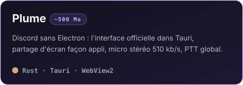
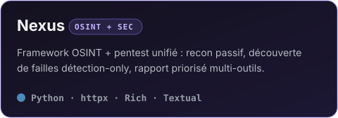
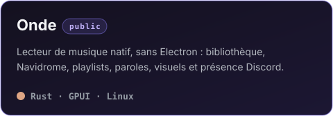

  

  <b>Des applis légères, rapides et qui ne t'espionnent pas.</b> 
  Moins d'Electron, moins de télémétrie, plus de natif.

---

### 🪶 Projets

  
  
  

### 🛠️ Avec quoi je bosse

  
  
  
  
  
  
  
  
  

### 🔒 Ce qui compte pour moi

- **La vie privée par défaut** — pas de pisteur, pas de compteur de visites, même sur cette page.
- **La performance** — une appli de chat n'a pas à manger 2 Go de RAM.
- **Le natif** — quand une page web suffit, on l'emballe proprement au lieu d'embarquer un navigateur entier.

### ☕ Soutenir

Tout est gratuit, sans pub et open source. Si mes projets te rendent service, un café m'aide à continuer.

  

---

  <i>« Big Brother is watching you » — pas ici.</i>

